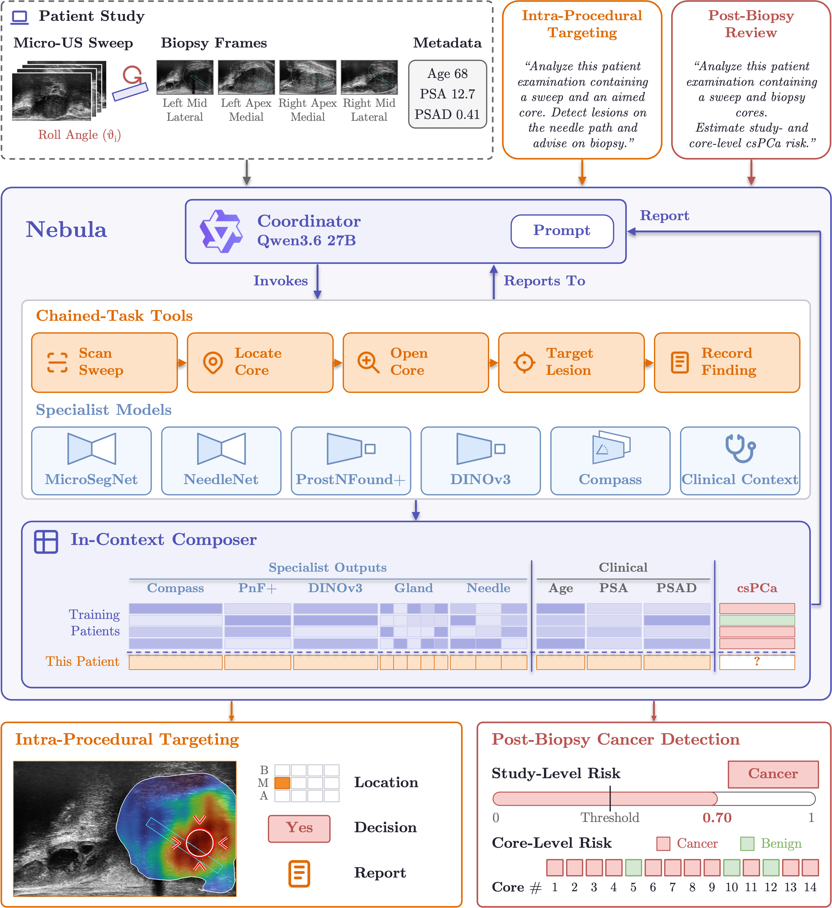

<p align="center">
  
</p>

<h1 align="center">Nebula</h1>

<p align="center">
  <b>Towards Reliable Agentic Copilots for Prostate Cancer Detection and Biopsy Targeting</b>
</p>

<p align="center">
  <a href="#architecture">Architecture</a> ·
  <a href="#installation">Installation</a> ·
  <a href="#usage">Usage</a> ·
  <a href="#reproducing-the-paper">Reproducing the paper</a> ·
  <a href="#citation">Citation</a>
</p>

---

Nebula is an agentic copilot for micro-ultrasound (µUS)-guided prostate biopsy. A locally run language model acts as the **coordinator**: it follows a written clinical protocol, calls specialised µUS **tools** one at a time, and hands their findings to an in-context **composer** (TabPFN-3) that turns them into cancer risk estimates and biopsy recommendations. The coordinator then writes a short, grounded report. 

Nebula currently fulfills two clinical workflows:

| Workflow | When | Question answered |
|---|---|---|
| **Post-biopsy review** | Every core has been taken, pathology is pending | Patient- and core-level risk of clinically significant cancer (csPCa, grade group ≥ 2), plus quality assurance: were the sweep's suspicious regions sampled, by which core, and did the needle hit the lesion? |
| **Intra-procedural targeting** | A core is aimed, the needle has not fired | Should this core be taken, and where is the suspicious region on the live frame? |

> **This repository contains code only.** No patient data (images, videos, clinical values, labels), derived features, or model weights are included. The only data-derived files are the patient IDs and fold assignments in `splits/`. All paths are read from `configs/paths.yaml`.

## Architecture

<p align="center">
  <a href=".img/nebula_method.svg">
    
  </a>
</p>

**Coordinator.** A local language model with greedy decoding, one tool call per turn, at most 30 turns (post-biopsy) or 14 (intra-procedural). Tools that are not repeatable leave the menu once called. If the budget runs out, the composer is forced on what was collected. After `compose`, the model writes the report without tools; the risk statement, margin and recommendation are worded by code, not by the model.

| `--agent` | Model | Notes | 
|---|---|---|
| `qwen` (default) | Qwen3.6-27B, thinking off (`--thinking` turns it on) | default |
| `gpt-oss` | gpt-oss-20b, low reasoning effort |  |
| `mistral` | Mistral-Small-3.2-24B-Instruct |  |

**Specialists** (one model per tool, `tools/<name>.py`; network code in `models/`)

| Specialist | Network | Modalities | Task |
|---|---|---|---|
| MicroSegNet | TransUNet R50-ViT-B/16 | frame | prostate segmentation |
| NeedleNet | same network, trained on needle masks | frame | needle track segmentation  |
| ProstNFound+ | MedSAM ViT-B with adapters, age / PSA prompts, 256 px | frame + age, PSA | core-level cancer detection |
| DINOv3 | DINOv3 ViT-L/16 + prompt-free mask decoder, 384 px | frame | core-level cancer detection |
| Compass | frozen ProstNFound+ backbone + BERT over sweep and core tokens, 224 px | sweep + cores + age, PSA | study-level risk stratification |

**The coordinator's tools** (`tools/registry.py`, implemented in `agent/session.py`). Fourteen tools map the protocol's
steps onto the specialists:

- `scan_sweep_targets`: up to five distinct hot spots on the sweep, ranked by an experience score over previous patients' labelled hot spots
- `similar_past_cases`: the five most similar labelled hot spots of previous patients for one target
- `locate_core`: side, zone and level of the aimed core, and which sweep targets lie at its angle and depth (intra-procedural only)
- `place_on_cores`: the core that sampled a sweep target, and the distance from the target to its track after registration
- `open_core`: a core's ProstNFound+ and DINOv3 scores in its track, their ranks, gland and track geometry
- `target_lesion`: the lesion on a core's frame, and whether the needle track crosses it
- `record_findings`: one quality-assurance finding
- `assess_gland`: prostate outline quality (MicroSegNet)
- `locate_needle`: needle-track quality (NeedleNet)
- `frame_cancer_map`: the ProstNFound+ map along the cores' tracks, or on the live frame
- `second_opinion_map`: the same summaries from the DINOv3 map
- `study_level_risk`: Compass
- `clinical_context`: age, PSA and pseudo PSA density
- `compose`: the composition; ends the task

The intra-procedural workflow only exposes the tools whose inputs exist before the needle fires: the other cores, their
tracks and any pathology are never touched.

**Composers** (`composer/`). Three TabPFN-3 classifiers in context over previous patients' tool outputs, five seeds averaged, missing inputs imputed with the context median:

| Composer | Inputs |
|---|---|
| Patient (post-biopsy) | 14: Compass, both maps over the cores' tracks, outline quality, age, PSA, pseudo PSA density |
| Core (post-biopsy) | 3: ProstNFound+ and DINOv3 track means, Compass per-core score |
| Targeting (intra-procedural) | 23: the live frame, the sweep at the core's angle, and the anatomy |

For a patient of the cohort, the context excludes their fold; for a new patient it uses the whole cohort.

## Installation

```bash
git clone https://github.com/mharmanani/Nebula
cd Nebula
pip install -r requirements.txt
cp configs/paths.example.yaml configs/paths.yaml   # then fill in your paths
```

### Requirements

- Python 3.11
- PyTorch 2.7, `transformers` ≥ 4.57, `tabpfn` 8.0 (see `requirements.txt` for the exact versions the paper used)
- The [`dinov3`](https://github.com/facebookresearch/dinov3) package (installed by `requirements.txt`)
- A GPU is needed for the coordinator and recommended for the specialists

### Configuration

`configs/nebula.yaml` holds the settings (`device`); `configs/paths.yaml` holds everything that is yours:

| Key | Description |
|---|---|
| `weights.microsegnet` | MicroSegNet checkpoint, or `null` for the public prostate weights (Hugging Face `pfrwilson/micro_seg_net`) |
| `weights.needlenet` | NeedleNet checkpoint (`scripts/train_needlenet.py`) |
| `weights.prostnfound` | ProstNFound+ checkpoint |
| `weights.dinov3` | DINOv3 cancer-head checkpoint (`scripts/train_dinov3_head.py`) |
| `weights.compass` | Compass checkpoint (trained with [Compass](https://github.com/mharmanani/Compass)) |
| `cohort` | Your cases, laid out as in [`docs/data_format.md`](docs/data_format.md) |
| `context` | The composers' labelled context, written by `scripts/build_context.py` |
| `coordinator.{qwen,gpt-oss,mistral}` | Local folders (or Hugging Face ids) of the coordinator models |

Both files can be overridden with the `NEBULA_CONFIG` and `NEBULA_PATHS` environment variables.

## Usage

**Nebula on one case**

```bash
# post-biopsy review of one patient
python3 run.py -m nebula --workflow post  --case /path/to/case

# intra-procedural targeting of one core: biopsy if P(csPCa) >= --threshold (default 0.14, the paper's)
python3 run.py -m nebula --workflow intra --case /path/to/case --core CORE_ID

# options: --agent qwen|gpt-oss|mistral   --thinking (qwen)   --fold K (exclude the patient's fold from the context)   --out episode.json
```

`--out` writes the whole episode as JSON: every tool call and its output, the composer result, the report, and a list of
any numbers in the report that no tool output supports.

**One specialist on its own**

```bash
python3 run_tool.py --tool prostnfound --modality frame --case /path/to/case     # frame | cine | sweep
python3 run_tool.py --tool microsegnet --modality sweep --case /path/to/case
python3 run_tool.py --tool compass --case /path/to/case                          # sweep + cores (as trained)
python3 run_tool.py --tool clinical --case /path/to/case                         # age and PSA
```

Add `--out DIR` to save the masks and maps as `.npy`. [`docs/tools.md`](docs/tools.md) lists what each tool takes and
returns.

## Data

Nebula was developed on the **OPTIMUM micro-ultrasound dataset**, a proprietary clinical dataset that is **not included** in this repository. To run Nebula, arrange your own data as described in [`docs/data_format.md`](docs/data_format.md): one folder per patient holding the rotational sweep (frames and per-frame probe roll), one folder per biopsy core (cine, fire frame, probe roll, field of view) and the clinical values. 

Folds are released in `splits/optimum_5fold_patient_splits.json` (patient IDs and fold assignments only);
`splits/excluded_patients.json` lists the four patients of the folds that are not in the paper's 156-patient evaluation.

## Reproducing the paper

Reproduction needs your own labelled cohort in the format above.

1. **Specialists.** No weights are released. MicroSegNet uses its public weights. Train NeedleNet (`scripts/train_needlenet.py`) and DINOv3 (`scripts/train_dinov3_head.py`). Compass is trained with its [public repository](https://github.com/mharmanani/Compass) (`configs/compass.yaml`); ProstNFound+ ships as a network only (see [`docs/tools.md`](docs/tools.md)). Set the checkpoints in `configs/paths.yaml`.
2. **Context.** `python3 scripts/build_context.py --out /path/to/context` runs the specialists on every case and builds the composers' labelled context out of fold, with the patient and core thresholds fixed by inner cross-validation.
3. **Composers.** `python3 scripts/evaluate.py --context /path/to/context` reports the three composers out of fold (AUROC, balanced accuracy, sensitivity at 60 % specificity; mean ± sd over folds).
4. **Nebula.** Run `run.py --out` on each held-out patient (or core) and evaluate the episodes with `scripts/evaluate.py --context /path/to/context --episodes runs.jsonl`.

## Citation

```bibtex
@misc{nebula,
  title = {Nebula: Towards Reliable Agentic Copilots for Prostate Cancer Detection and Biopsy Targeting}
}
```

If you use the study-level model, please also cite [Compass](https://github.com/mharmanani/Compass):

```bibtex
@inproceedings{wilson2026compass,
  title     = {Compass: Prostate Cancer Detection Needs Multi-View Context},
  author    = {Wilson, Paul F. R. and Harmanani, Mohamed and Guo, Zhuoxin and Dzikunu, Obed K. and Cash, Hannes and Kinnaird, Adam and Wodlinger, Brian and Abolmaesumi, Purang and Mousavi, Parvin},
  booktitle = {International Conference on Medical Image Computing and Computer-Assisted Intervention (MICCAI)},
  year      = {2026}
}
```

## Acknowledgements and License

Third-party network code in `models/` (MicroSegNet, Segment Anything / MedSAM, Compass) is listed with its sources and
licenses in [THIRD_PARTY_NOTICES.md](THIRD_PARTY_NOTICES.md) and keeps its own license. DINOv3, TabPFN and the
coordinator language models are installed as dependencies under their own licenses.

The rest of this repository is released under the [PolyForm Noncommercial License 1.0.0](LICENSE.md): free for research,
teaching, personal study and use by non-profit, academic, public research, public health and government organisations.
Commercial use requires a separate license; please contact the authors.
